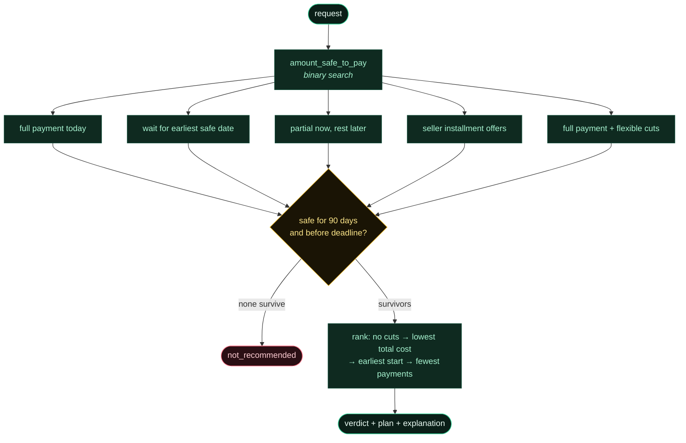
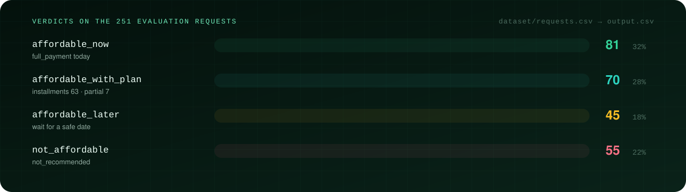

<div align="center">



<br/>

<a href="https://github.com/priyanshusharan-cmd/afford-ai/releases/latest"></a>


<a href="LICENSE"></a>


<h3>Your balance says yes. Your next 90 days might say no.</h3>

<p>
AffordAI is a financial decision agent that answers one question with a guarantee:<br/>
<b>can you pay for this without ever dropping below the balance you promised yourself?</b>
</p>

<p>
<a href="#-what-it-decides"><b>Verdicts</b></a> ·
<a href="#-how-it-works"><b>How it works</b></a> ·
<a href="#-decision-logic"><b>Decision logic</b></a> ·
<a href="#-results"><b>Results</b></a> ·
<a href="#-quickstart"><b>Quickstart</b></a> ·
<a href="#-output-schema"><b>Output</b></a>
</p>

</div>

<br/>

## 💡 Why AffordAI

A balance check tells you what you have **today**. It says nothing about the rent leaving in nine days, the pending card charge that hasn't cleared, or the salary that only lands on the 28th.

AffordAI rebuilds each user's real financial picture: recurring bills, pending debits, confirmed income, foreign-currency spend, seller payment offers and the evidence hiding in messages and receipt images. It then **simulates every day of the next 90**. A plan is recommended only if the balance stays above the user's own minimum on every one of those days.

Two people with the same balance can get different answers, because their commitments, priorities and payment preferences differ.

<br/>

## 🎯 What it decides

For every request, AffordAI returns one of four verdicts plus a concrete, dated payment plan:

| | Verdict | Method | What it means |
| :-: | :-- | :-- | :-- |
| 🟢 | `affordable_now` | `full_payment` | Pay it all today and the next 90 days are still safe. |
| 🔵 | `affordable_with_plan` | `installments` · `partial_payment` | Safe if you split it up or trim a flexible expense. |
| 🟡 | `affordable_later` | `wait` | Not today, but there's a safe date before your deadline. |
| 🔴 | `not_affordable` | `not_recommended` | No safe path exists within the deadline. |

<br/>

## ⚙️ How it works



<details>
<summary><b>01 · DataLoader</b> &nbsp;<sub><code>code/data_loader.py</code></sub></summary>
<br/>

Loads profiles, 25k+ financial events, dated exchange rates, seller payment options, messages, image links and requests. It normalises dates and amounts so every later stage works in the user's home currency.
</details>

<details>
<summary><b>02 · AIParser</b> &nbsp;<sub><code>code/ai_parser.py</code></sub></summary>
<br/>

Gemini reads receipts and screenshots to recover **missing transaction amounts**, and interprets messages that amend, delay, cancel or confirm an event. OpenAI is used as a fallback. If no key is set or the API is rate-limited, deterministic regex heuristics take over, so the pipeline always finishes. Messages and images are treated as **untrusted evidence**: they can change facts, never rules.
</details>

<details>
<summary><b>03 · StateBuilder</b> &nbsp;<sub><code>code/state_builder.py</code></sub></summary>
<br/>

Reconstructs the balance on `request_date`, applies message amendments, resolves conflicting records (explicit cancellation → newer record → settled → safer reading) and detects recurring patterns such as rent and salary. Patterns that have stopped are expired. Bonuses, commissions, refunds and unrealised gains are **never** counted as future income.
</details>

<details>
<summary><b>04 · Simulator</b> &nbsp;<sub><code>code/simulator.py</code></sub></summary>
<br/>

Projects the next 90 days of cash flow and checks the balance against `minimum_balance_to_keep` after every expense and payment. A **binary search** finds the exact `amount_safe_to_pay` to two decimals, precise enough for IDR-scale amounts in the tens of millions. It also finds the earliest safe date for a single full payment.
</details>

<details>
<summary><b>05 · DecisionEngine</b> &nbsp;<sub><code>code/decision_engine.py</code></sub></summary>
<br/>

Builds every candidate plan, keeps only those that survive the simulation and the deadline, ranks the survivors and writes a short, grounded explanation.
</details>

<br/>

## 🧭 Decision logic



Each candidate respects the user's own rules: payment methods they'll consider, `max_installment_months`, protected spending categories, and whether the request allows partial payment.

<br/>

## 📊 Results



<div align="center">

| 🧾 Requests | 👤 Profiles | 📒 Financial events | 💬 Messages | 🖼️ Receipt images | 💱 Currencies |
| :-: | :-: | :-: | :-: | :-: | :-: |
| **251** | **276** | **25,343** | **215** | **16** | **INR · EUR · IDR · ZAR · USD** |

</div>

All 251 requests in `dataset/requests.csv` get a prediction in [`output.csv`](output.csv), across nine request types from `purchase` and `travel` to `debt_repayment` and `emergency_expense`.

<br/>

## 🚀 Quickstart

```bash
git clone https://github.com/priyanshusharan-cmd/afford-ai.git
cd afford-ai
python3 -m venv venv && source venv/bin/activate      # Windows: venv\Scripts\activate
pip install -r requirements.txt
```

**Optional: turn on the AI evidence parser.** Put your keys in a `.env` file at the repo root (it is git-ignored), or export them:

```bash
GEMINI_API_KEY=your_gemini_key
OPENAI_API_KEY=your_openai_key       # fallback
GEMINI_MODEL=gemini-3.7-flash        # optional override
```

> [!TIP]
> No keys? No problem. AffordAI falls back to deterministic heuristics and still produces every prediction.

**Run it:**

```bash
python3 code/main.py                  # all requests → output.csv + evaluation/usage_report.md
python3 code/main.py --mode=sample    # sample requests → dataset/sample_predictions.csv
cd code && python3 sample_scorer.py   # compare sample predictions with the expected answers
```

<br/>

## 🧾 Output schema

Every row in `output.csv` is one decision:

| Column | Description |
| :-- | :-- |
| `amount_safe_to_pay` | Maximum amount payable **today** without breaching the minimum balance. |
| `affordability_status` | `affordable_now` · `affordable_with_plan` · `affordable_later` · `not_affordable` |
| `recommended_payment_method` | `full_payment` · `partial_payment` · `installments` · `wait` · `not_recommended` |
| `payment_plan` | Chronological `YYYY-MM-DD:amount` entries joined by `\|`, or `none`. |
| `earliest_date_for_full_payment` | First safe date for a single full payment. |
| `spending_changes_needed` | Up to three `stop:<event_id>` / `reduce_to:<event_id>:<amount>` actions, or `none`. |
| `decision_explanation` | A short, human-readable reason grounded in the numbers. |

<details>
<summary><b>See a real row</b></summary>
<br/>

```csv
request_id,amount_safe_to_pay,affordability_status,recommended_payment_method,payment_plan,earliest_date_for_full_payment,spending_changes_needed,decision_explanation
request_27,6670.0,affordable_now,full_payment,2026-07-05:6670,2026-07-05,none,Pay 6670.0 today. This keeps the 20500 minimum available over the next 90 days.
```
</details>

<br/>

## 🛡️ Design principles

- **The math decides, the model only reads.** The LLM extracts evidence. The verdict comes from a deterministic simulator, so the same input always gives the same answer.
- **Conservative by default.** Pending debits are reserved, unconfirmed income is ignored and essential variable spending is forecast on the safe side.
- **Your rules win.** Protected categories, installment limits and payment preferences are hard constraints, not suggestions.
- **No secrets in code.** Keys come from the environment only.

<br/>

## 🗂️ Project structure

```text
afford-ai/
├── code/
│   ├── main.py             # entry point: runs the pipeline, writes output + usage report
│   ├── data_loader.py      # CSV ingestion and normalisation
│   ├── ai_parser.py        # Gemini / OpenAI evidence extraction + heuristic fallback
│   ├── state_builder.py    # balance reconstruction, conflicts, recurring patterns
│   ├── simulator.py        # 90-day forecast + binary search
│   ├── decision_engine.py  # candidate plans, ranking, explanations
│   └── sample_scorer.py    # sample accuracy check
├── dataset/                # challenge data (profiles, events, FX, offers, media)
├── evaluation/usage_report.md
├── output.csv              # final predictions
└── problem_statement.md
```

<br/>

<div align="center">


<sub>Built by <a href="https://github.com/priyanshusharan-cmd"><b>Priyanshu Sharan</b></a> for <b>HackerRank Orchestrate · Buy or Wait?</b> · Released under the <a href="LICENSE">MIT License</a></sub>

<br/><br/>

<a href="https://www.linkedin.com/in/priyanshusharan"></a>
<a href="https://github.com/priyanshusharan-cmd"></a>

</div>
